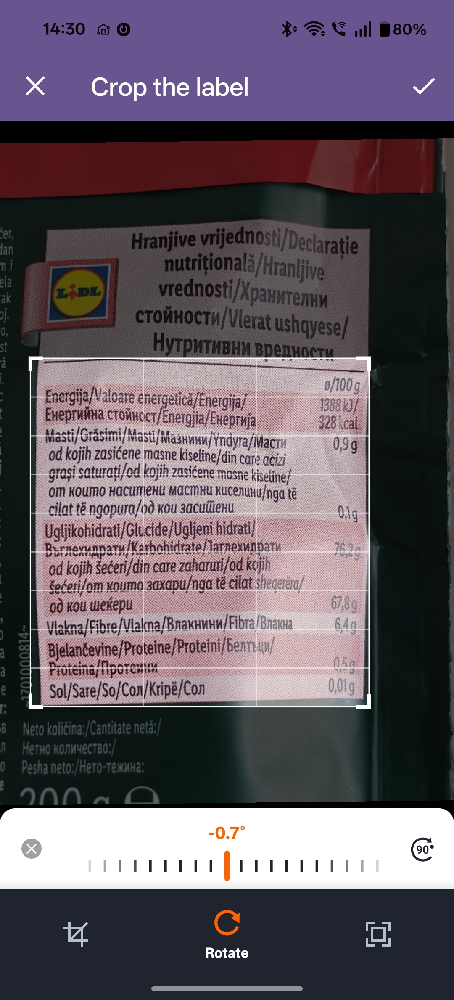
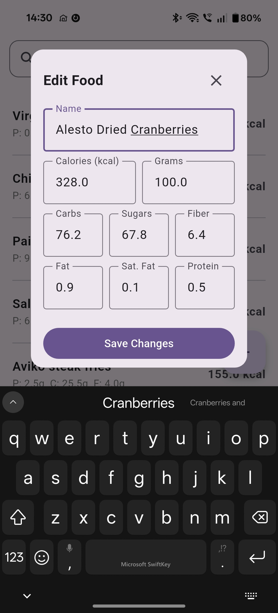
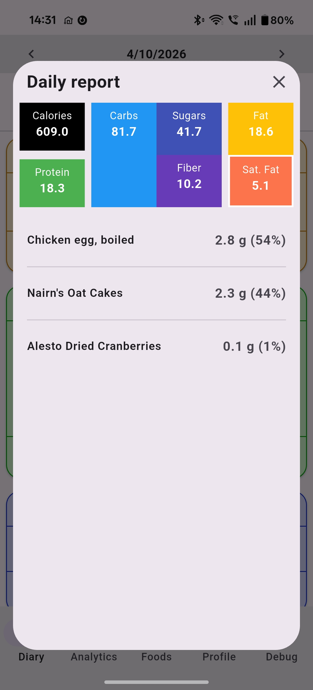
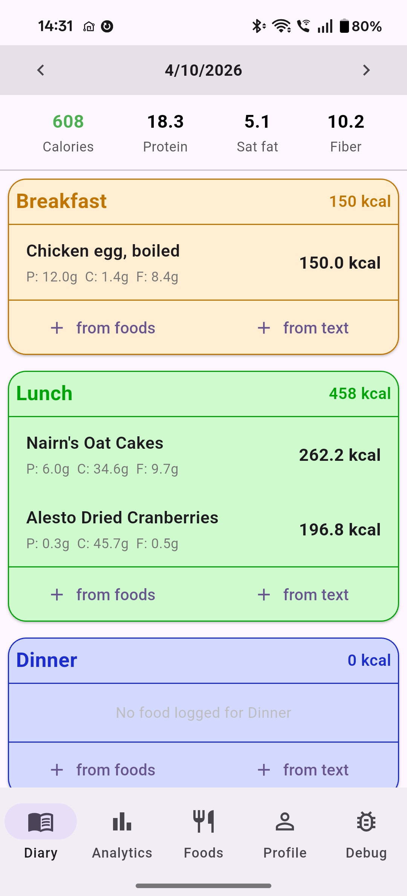

# Local AI Calorie App

An offline nutrition tracker built with Flutter. It runs a Gemma model directly on the phone to read nutrition labels, so nothing is sent to the cloud and no internet connection is needed.

Built as a personal project. It isn't published on any app store.

## Screenshots

| Label scan | Validation form | Daily report | Diary |
|:---:|:---:|:---:|:---:|
|  |  |  |  |

## Features

- **Label scanning:** take a photo or pick one from the gallery, and Gemma extracts the nutritional values from the label.
- **Validate before saving:** parsed values are shown in an editable form, so you always confirm or correct them before they are stored.
- **Manual entry:** add foods with the same form, no scanning required.
- **Quick estimates:** type a simple food like "banana", "avocado" or "fried chicken" and get an on-the-fly nutritional estimate from the model.
- **Daily report:** a summary of what you ate today.
- **Weekly report:** work in progress.
- **Fully local:** data is stored in SQLite on the device, and inference runs on the phone.

## How it works

1. On first run, the app asks you to select the downloaded Gemma model file and stores it in its internal storage.
2. The label image is passed to the on-device model running on the phone's GPU.
3. The model returns the values, which are parsed and placed into an editable form.
4. The user reviews or edits the values, then saves them to SQLite.

### Making it fast

On-device inference is slow enough that output length matters a lot. Early versions asked the model for JSON, but that was too slow. The current version asks for only the numbers, separated by commas, in a fixed order, and the app maps them to fields. Combined with a compact prompt, this cut response time significantly.

## Tech stack

- Flutter / Dart
- Gemma 4 E2B (`gemma-4-E2B-it.litertlm`), running fully on-device (flutter_gemma package)
- SQLite for local storage

## Setup (if you want to install it)

The app isn't published on any app store, so you need to build it yourself on a computer and install it on an Android phone.

> **Model not included.** The Gemma model must be downloaded separately and is subject to Google's Gemma terms of use. Search for `gemma-4-E2B-it.litertlm` on Kaggle or Hugging Face.

### 1. Build the app (on a PC)

**Requirements:** Flutter SDK 3.44, Android SDK (installed with Android Studio), and `flutter doctor` reporting no Android issues.

```bash
git clone https://github.com/LoraSomething/local-calories
cd [repo folder]
flutter pub get
flutter build apk --release
```

The APK is created at `build/app/outputs/flutter-apk/app-release.apk`.

### 2. Install it on the phone

Either copy the APK to the phone and open it (you may need to allow installs from unknown sources), or connect the phone with USB debugging enabled and run:

```bash
flutter install
```

### 3. Add the model

1. Download `gemma-4-E2B-it.litertlm` and put it on the phone (directly, or copy it over USB).
2. Open the app. On first launch it asks you to pick the model file, then copies it into the app's internal storage. You only do this once, and afterwards the file you downloaded can be deleted.

**Tested on:** OnePlus Nord 5 (Android). Other devices may work, but I haven't tried them. A phone with enough RAM and a capable GPU is recommended.

## Limitations

- Label parsing isn't perfect, which is why every result goes through user validation.
- Estimates for simple foods are approximate.
- Tested on a single device.

## Status

Personal project, used daily by me. The weekly report is still in progress.